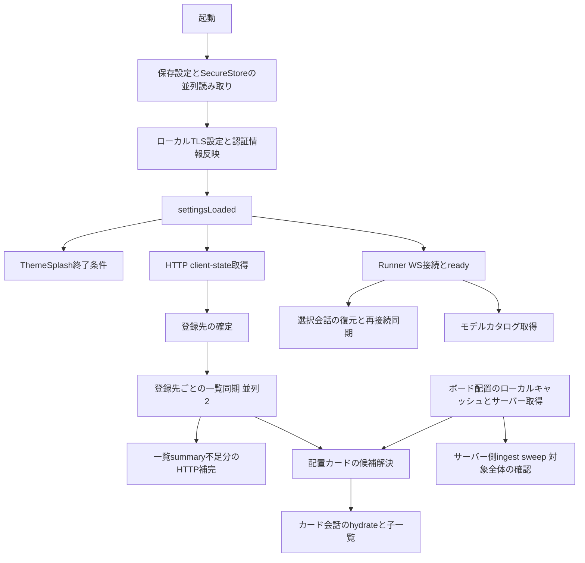

# Bitty 起動と初回同期の設計

作成日: 2026-10-27
状態: 専用worktreeで実装・自動テスト済み（2026-10-27）。main・稼働Runner・実機には未適用。
調査開始の基準: `e891073`。実装の統合基準: `d2a0ea5`（既存の接続indicator改善を維持）。前提: [作業手順](GIT-WORKTREE.md)、[前回の改善結果](初回セッション同期-改善計画.md)。

実装済み: WS readyでのintent開始、cycle内hello 1回、上限付き全登録先batch、旧server fallback、接続・認証scope分離、部分失敗の表示保持と再取得、Claudeの不要な子列挙の削除。最新の実装・検証記録は第18節。
未実装: 永続一覧cache、一覧ETag、内部の全登録先走査を1回へまとめる変更。既存メモリcacheは維持し、実機の起動・復帰速度は未検証。

## 1 目的と採用する方向

最新情報を取得する動作を維持しながら、起動時の不要な要求と待ち時間を発生源で減らす。
「画面が表示された」「表示中の会話が最新になった」「全登録先の一覧を確認できた」を別の完了条件として扱う。
キャッシュを表示できたことだけで、最新同期が完了したことにはしない。

次の主施策は、最新取得を維持し、全登録先の先頭ページ一覧を既存WebSocketの1つのbatch要求にまとめることである。特定directoryの先行取得は追加しない。表示中popupの本文は既存の独立したhydrate・resume・live経路で最新化し、一覧batchの完了を待たせない。登録先そのもののHTTP `client-state`取得とは区別する。
単一batchの上限内で25登録先をすべて実取得する通常成功時は、hello 1回＋一覧batch 1回の計2要求を想定する。実取得対象なしなら0要求。上限超過・TTL skip・失敗回復・旧serverへのfallbackでは要求数が変わる。`llmDirectory`やpopupから一覧の優先先を選ぶ処理、作業directoryの変更、新しい優先制御層は不要とする。
全登録先の先頭ページ、limit、cursor、summary、title、read state、部分失敗の既存契約を維持する。取得対象を表示中だけに狭めず、画面ごとの再試行や独自cacheを増やさない。
最初の変更ではservice内部の25回のfresh取得を維持してよい。Claudeの不要な子列挙の削除と、同じ全体走査の繰り返しを減らす修正は、その後に独立して検証する。通信をまとめるだけで走査も減るとは扱わない。

永続キャッシュは既にボード配置と会話本文にある。これらを再実装せず、必要なら一覧の先頭ページだけに追加する。
永続一覧キャッシュの採用は、表示待ちへの寄与と接続先の分離を確認した後の独立した変更とする。
第17節の全件batchで得た2.361→0.257秒は各WS要求へ80msを注入した人工条件であり、実機の6.7秒がその値へ変わるという結果ではない。6.7秒の支配的な原因はまだ確定していない。最小限の基準計測と契約テストを用意し、修正後に同じ実機条件で全一覧完了とpopup本文・ボードpreviewへの影響を確認する。

## 2 現状の依存関係と確認済みの事実



この図は依存関係であり、実行順序を保証するものではない。現状の一覧開始条件は`settingsLoaded`で、WS readyは別経路である。
ボードの候補解決には一覧以外に、配置カードの出所情報を使うsummary取得経路もある。

| 確認事項 | コード上の根拠 | 設計への意味 |
| --- | --- | --- |
| 設定と認証情報を並列読み取りし、TLS適用後にsettingsLoadedを立てる | [useAppSettingsPersistenceController.ts](../expo/src/features/app/hooks/useAppSettingsPersistenceController.ts) の `loadSettings`、`applyPersistedSettings` | この安全な接続準備を短縮目的で飛ばさない |
| Splash終了はsettingsLoadedに依存する | [AppRoot.tsx](../expo/src/features/app/AppRoot.tsx) の `ThemeSplash` | 全一覧同期がアプリ全体の表示を直接ブロックする構造ではない |
| 登録先は空で始まり、client-stateから反映される | [useRunnerClientState.ts](../expo/src/features/app/hooks/useRunnerClientState.ts) の `applySnapshot` | 初回一覧には設定だけでなく登録先の取得が必要 |
| 一覧は並列2、メモリTTLは60秒。選択中の登録先を優先する | [AppRoot.tsx](../expo/src/features/app/AppRoot.tsx) の定数、[useDirectorySessionTreeController.ts](../expo/src/features/app/hooks/useDirectorySessionTreeController.ts) の `runSyncCycle`、`buildOrderedSyncTargets` | 登録先の数だけ待ち行列ができる。並列数増加だけで解決しない |
| screen_mount、設定ロード後のauth_recovery、登録先変更などが同期intentを発行する | [useSkiaMiniChatSessions.ts](../expo/src/features/app/hooks/useSkiaMiniChatSessions.ts)、`AppRoot`、一覧controller | 同期intentの併合は既にある。トリガー数を実要求数と同一視しない |
| 一覧controllerのbootstrapReadyはsettingsLoadedだけである | `AppRoot` の `useDirectorySessionTreeController` 呼び出し | inactiveやready前の要求を失敗後に回収する場合がある |
| 起動会話復元はWS readyを待つ。復帰同期にも起動復元との競合回避がある | [useSessionStartupRecoveryController.ts](../expo/src/features/app/hooks/useSessionStartupRecoveryController.ts)、[useReadyDrivenResumeSyncController.ts](../expo/src/features/app/hooks/useReadyDrivenResumeSyncController.ts) | 二重復元防止を新設せず、既存契約を保つ |
| 各Agent一覧はhelloで互換性とbackendを確認してからsessions.listを送る | [agent/client.ts](../expo/src/features/agent/client.ts) の `listAgentSessions` | 一覧の往復に接続確認が含まれる。helloを単純削除できない |
| モデルカタログもready世代ごととpicker表示時にhelloを使う | [useAgentModelCatalog.ts](../expo/src/features/app/hooks/useAgentModelCatalog.ts) | 同時helloの共有候補。動的なモデル選択の更新を維持する |
| Codex一覧はindexを更新確認し、ページのsummaryを読む | [llm-cli-session-index.mjs](../private_runner/src/llm-cli-session-index.mjs) の `refreshCliSessionIndex`、[llm-session-service.mjs](../private_runner/src/llm-session-service.mjs) の `listLlmSessions` | 再読取だけでなく列挙・stat・summaryの時間を分離する必要がある |
| Claude一覧もファイル列挙とmetadata確認を行う | [claude-backend.mjs](../private_runner/src/claude-backend.mjs) の `listSessionsForDirectories`、`transcriptMetadata` | 小さいページでも全候補の確認が発生し得る。statが同じmetadataは既に再利用される |
| all-backends一覧は各backendの結果を待って合成する | [agent-service.mjs](../private_runner/src/agent/agent-service.mjs) の `listSessions` | backendごとの所要時間と部分失敗を分けて見る |
| ボードGETもingest sweepを待つ | [skia-board-http.mjs](../private_runner/src/skia-board-http.mjs)、[skia-board-ingest.mjs](../private_runner/src/skia-board-ingest.mjs) の `sweep` | ボード配置取得の背後にも全登録先の確認がある。単なる小さい状態GETとは扱わない |

TTS音声カタログは`loadVoices`を呼ぶ取得方式で、自動起動通信とは確認できない。
モデルカタログ、Git情報、利用量照会などは、依存の有無と資源競合を区別して計測する。
ボードingestは既定30秒間隔で進行中要求を共有し、失敗でも間隔の起点が進むため、ボードGETのたびに外部CLIの新規会話を再確認する保証はない。
ingestの複数登録先照会はCodex indexのforce更新を使う。通常の一覧確認と重なる場合の追加走査は計測対象であり、既存のforce更新を進行中走査へ単純合流させない。

## 3 実測から分かることと未確定のこと

[前回の改善結果 第12節](初回セッション同期-改善計画.md)では、2026-10-26の初回25登録先の一覧完了が中央値6.724秒だった。
97行の一覧・snapshotを維持し、空一覧を除く23要求中21要求でHTTP補完が不要になった。
これは計測開始から一覧完了までの代理指標で、画面描画・操作可能・会話の最新化までの時間ではない。

今回参照した`private_runner/logs/client_auto_logs/20261027_092916_451.jsonl`でも、iOSの最初の異なる25登録先への一覧完了を確認した。
集計条件は、端末内の診断session単位、先頭`session_diag.at`を起点、60秒以内の各directoryの最初の`session_history_fetch_done`である。

| 先頭診断の時刻 JST | 25登録先の完了まで | 観測 |
| --- | ---: | --- |
| 2026-10-27 09:34:09.520 | 7.984秒 | 初回25登録先のHTTP補完要求対象は計4 ID |
| 2026-10-27 10:09:49.151 | 8.778秒 | 計4 IDの補完に加え、inactiveによるWS開始拒否とready時の一覧再試行イベントを観測 |

前回とは起点・実行条件が異なり、速度の前後比較には使わない。診断ログには間引きがあり、イベント件数を実HTTP回数とは扱わない。
会話本文、音声、操作内容はこの集計の対象外である。

確認できた構造上の問題は、設定ロード完了と一覧を実行できる接続状態の境界が異なり、通常起動にも失敗と回復の経路が入り得ること。
同時のhello、登録先ごとのサーバー列挙、カード本文取得との競合は待ち時間の候補だが、それぞれが何秒を占めるかは未確定である。
「履歴全体の走査が6.7秒の主因」「HTTP補完をなくせば十分」とは判定しない。

## 4 完了条件と起動時に待つ処理

| 状態 | 完了条件 | 待つ処理 |
| --- | --- | --- |
| 端末UI準備済み | 設定が反映され、画面の操作枠を描画できる | 現行の安全な設定・認証・TLS準備 |
| 保存表示を復元済み | 利用可能なローカル表示を描画できる | ボードcache等。最新確認前であることを保持 |
| 表示中の会話を最新確認済み | 対象会話の取得・差分とlive復旧結果を適用できる | 対象会話の認証済み取得。ライブ応答中は既存復旧経路を優先 |
| 全登録先の一覧を最新確認済み | 現在の対象revisionの先頭ページ取得と必要なsummary補完が成功する | 各登録先の初回ページ。子一覧・本文・全履歴ページは含めない |
| 一部確認失敗 | 対象に失敗やbackend部分失敗が残る | 成功済み表示は保持するが、全件最新とはしない |

「最新確認済み」は取得処理の観測点までの情報であり、その後の同時更新が存在しない保証ではない。
常時の更新、再接続・復帰・手動更新は既存の更新契機で追随する。
全登録先の進捗は既存の`DirectorySessionSyncState`を使い、単に同期中表示を早く消す変更はしない。
backendの部分失敗は現在ログに記録されるが、全件の鮮度を保証する表示契約は実装前に確認する。

起動の前景では、接続準備、ボード配置、選択会話・表示カードの最新取得を優先する。
全登録先の一覧取得は並行して継続し、会話本文や子一覧の完了と束ねない。
モデル情報は会話復元やモデル選択にも使われるため取得を削除しない。
画面に不要な情報を遅延する変更は、計測で資源競合が確認された項目だけに限定する。
配置カードのsummary直接取得を主経路にする将来案には、一覧cycleIdに依存する現行の更新契機と、出所directoryを持たない旧カードへの対応が必要である。
カード名に使う`firstUserMessage`も必要なため、Explorerと同じ省略を適用しない。今回この経路の置換は行わない。

## 5 修正する既存境界

第17節を受けた現行の実装案は第5.3節である。接続開始の安全性と互換性確認もその前提として扱い、実装順序は第8節に従う。

### 5.1 一覧の開始条件を実行可能な接続状態に合わせる

一覧controllerの既存bootstrap待ちとintentキューを使い、設定済みかつRunner WS readyになるまで要求を保留する。
WS接続そのものは`RunnerWebSocketManager`とProviderが開始し、一覧の開始を待たない。循環待ちを作らない。
HTTPのみのclient-state取得はWS readyを待たせない。

登録先は保留中にも更新されるので、drain時に現在の対象から作り直す既存動作を保つ。
ready時は保留intentを一度drainし、screen_mountとauth_recoveryなど同じ対象への要求を既存規則で併合する。
切断後に進行中要求が失敗する場合の回復は維持し、正常起動を先に失敗させるためだけの経路を不要にする。
既存の回復controllerを丸ごと削除するかは、接続中断・部分失敗のテストで役割が残るか確認して決める。

主な変更候補は`AppRoot`の実行条件の結線と`useDirectorySessionTreeController`の開始境界である。
一覧を使う画面ごとにready待ちやタイマーを追加しない。
通常のコールド起動でready前の一覧要求がなくなることを合格条件とし、秒単位の効果は実測で判断する。

### 5.2 同期cycle内の互換性確認を1回にする

実取得対象がある同期cycleでは、同じmanager・URL・token・接続generationのhelloを1回だけ行い、そのcycleの一覧要求に必要なprotocolとbatch対応を確認する。登録先ごとに同じhelloを繰り返さない。
結果の利用範囲はそのcycle内の同一接続に限定し、cycle終了・失敗、URL/token/generation変更で破棄する。途中で接続が変われば古い応答を適用せず、既存の回復経路で新しいcycleを確認し直す。
これはbackend readinessやモデル一覧を接続期間中ずっと固定するcacheではない。Agent serviceは各一覧でbackend状態を新しく確認し、UIのモデルカタログなど別用途のhelloは既存の更新契機を保つ。
旧protocolとraw fallbackの契約は維持する。batch非対応なら、確認済みの互換性情報を使いつつ、既存の登録先ごとの一覧要求へ戻す。fallbackのために新しいpollや再試行タイマーを追加しない。
第11節の進行中helloだけを共有する試案とは異なり、今回は全登録先の一覧を取得する1つのcycleを確認単位とする。

### 5.3 全登録先の一覧を1つのWS要求にまとめる

対象は登録済みdirectoryのtop-level先頭ページ（all-backends・parent指定なし）に絞る。既存ensure/refresh規則で実取得対象を決め、cycleのhello後に全対象をbatchで送る。子一覧、追加ページ、単独backend一覧、会話復元、モデルカタログは既存経路を維持する。TTL skipを今回ネットワーク確認済みとして扱わず、TTLを延ばして通信を隠さない。
一覧の取得順序を`llmDirectory`やpopupの状態から決めない。batch化で不要になる選択directoryの並べ替えは削除し、新しい優先path入力やpopup selectorを作らない。
既知のpopupの本文は[useOpenSessionHistoryPopup](../expo/src/features/app/hooks/useOpenSessionHistoryPopup.ts)から[AppRoot](../expo/src/features/app/AppRoot.tsx)の`hydratePanelFromSessionHistory`を経て`fetchRunnerSessionMessagesCached`で直接取得できる。resumeも既存panelのsession・directoryで同じhydrateを呼ぶ。一覧metadataを補助に使う経路はあるが、既知のsessionとdirectoryを持つ本文取得を全一覧待ちに変えない。新しい復元層は追加しない。
ボードpreviewや新しいカードの候補解決は一覧・summaryにも依存するため、全UIが一覧と独立しているとはしない。batch前後で本文更新とカード表示を別々に確認し、共有資源の競合や全結果適用時の処理集中も計測する。
各登録先のlimit 5、独立したcursor、Runner summary、共有title、read stateを同じ一覧契約で返す。成功した空一覧と失敗を区別し、1登録先や一部backendの失敗で他の成功を捨てず、失敗した対象だけを既存の回復対象に残す。

| 既存の境界 | 変更する責務 |
| --- | --- |
| 一覧controller | intentの併合、対象revision、進捗・error・tree適用を維持し、全実取得対象をまとめて渡す。画面側に取得判断を複製しない |
| Agent client | cycleのhello結果でbatch対応を確認し、既存WSで送受信する。未対応serverでは同じ一覧契約の個別要求に戻す |
| Agent WS transport | 認証済み接続のsubjectと既存の要求制約を維持し、batchの入力形式・件数・サイズを検証してserviceへ渡す。ここへ一覧の合成や再試行判断を持ち込まない |
| Agent service | まずは既存`listSessions`を対象ごとに並列2で呼び、独立した結果とerrorをまとめる。backend状態・cursor・summary・title・read stateの責務を再実装しない |

`listSessionSnapshot`はunpagedで、現行一覧とsummary・title・cursorなどの契約が揃わないため、先頭ページAPIの代用品にしない。最初から一覧基盤を置き換えず、既存のservice呼出を1つのwire要求にまとめる最小の変更にする。
既存の一覧が持つ認証・subject・cwdの可視範囲をbatchでも広げない。現在`service.listSessions`がexecution用`workspaceAdmission.assertAllowed`を呼ぶ実装ではないことも踏まえ、最適化のついでに別の厳しいadmission policyを追加しない。
batch非対応が事前に分かる場合は最初から個別要求にし、未対応errorでも既に成功した対象は再取得しない。受理後のtimeout・切断では全対象へ即座に再送せず、既存の失敗・世代・対象別回復に従う。新しいタイマーや二重の回復層を作らない。

## 6 キャッシュの扱い

| データ | 現在の再利用 | 今回の方針 |
| --- | --- | --- |
| ボード配置 | [SkiaBoardContext.tsx](../expo/src/features/app/contexts/SkiaBoardContext.tsx) の永続読み取り専用cacheとサーバーrevision | 活用を維持。サーバー反映後に遅いcacheを適用しない既存順序を守る |
| 会話本文 | [useSessionMessagesCacheController.ts](../expo/src/features/app/hooks/useSessionMessagesCacheController.ts) の永続cacheとsinceCursor差分 | 毎回のサーバー照会を維持。差分失敗は既存の全取得へ戻す |
| client-state | [runnerClientState.ts](../expo/src/features/app/utils/runnerClientState.ts) のメモリsnapshotとETag | 304を活用。cold起動では消える。poll間隔の延長で速く見せない |
| 登録先の一覧 | 一覧controllerのメモリTTL、起動時は空 | 永続cacheは次段階の候補。最新取得の代わりにはしない |
| Codex index | 永続index、mtime・size照合、進行中更新の共有 | 既存再利用を維持。走査時間を計測してから変更する |
| Claude metadata | ファイル情報に基づくmetadata再利用 | 同様に列挙と解析を分けてから変更する |

一覧cacheを採用する場合は、既存の一覧controllerが成功確定した先頭ページを保存・復元する。
保存するのは表示に必要な行と取得時刻だけとし、本文・全ページ・子ツリー・生の認証情報は含めない。
件数・容量の上限を設け、破損や形式不一致は通常の新規取得へ戻す。新しい汎用cache層は作らない。

接続設定の復元後、保存表示の読み取りと最新一覧要求を並行させる。ディスクcacheの読取終了を通信開始条件にしない。
cacheから表示した木は「表示可能」だが「今回の取得成功」ではない。60秒TTLを満たす取得済み状態として扱わず、cold起動の最新要求を必ず行う。
サーバー成功後に古いcacheを適用せず、更新中に進んだ既読時刻も巻き戻さない。
失敗時は保存表示と確認失敗を保持し、成功した空一覧でのみ古い行を除く。

保存領域は安定したRunner識別、backend、canonical directory、一覧条件、形式versionで分離する。
同一RunnerのLANとTunnelは同じデータを使える一方、別Runnerや認証スコープには流用しない。
現状のclient-stateの接続識別を利用できるか確認し、tokenを通常ファイルに保存しない識別方法を実装前に確定する。
この条件を満たせない場合、永続一覧cacheは追加せず、既存cacheの維持とWS要求の整理を先行する。ETagによる変更なし本文の省略も独立した後続案とし、今回のWS batchの実装条件にはしない。

## 7 最新性と競合に関する契約

- cold起動では、保存表示があっても現在の接続・登録先の初回確認を行う。再接続時は、既存の対象別の回復・再検証契機をcacheがあることを理由に省かない。毎ready時の全登録先強制更新は追加しない。
- 外部CLIの作成・追記・削除をRunner内のイベントだけで検出したことにしない。indexの現行確認間隔とforce更新の契約を守り、必要な再列挙を省略しない。
- Codex indexの通常更新確認には既定5秒の最小間隔がある。TTL内の一覧応答を外部変更の即時反映保証とは呼ばず、今回の変更でその間隔を伸ばさない。
- ボードingestの30秒間隔、一覧の60秒TTLも既存の範囲として扱う。ボードGETだけを全一覧の最新確認の代用にしない。
- 新規・更新・削除・rename、同じサイズの更新、圧縮ファイルへの置換を隔離フィクスチャで検証する。mtime・size一致だけの既存検出限界を新たな鮮度保証に使わない。
- 一覧の先頭ページ成功は、そのページの置換を意味する。続きページを取得していないことと、セッションが削除されたことを区別する。
- backend部分失敗やraw fallbackを完全なall-backends最新結果として固定しない。成功backendの表示を残し、未確認backendを再取得できることを保つ。
- 登録先削除・path変更では、既存のtarget revisionとgenerationによる古い応答の破棄を維持する。
- Runner変更時の一覧分離は、`useRunnerClientState`の登録先リセットと一覧controllerの更新順序を検証する。同一pathが両Runnerにある場合も古い応答を適用しないことを確認し、既存のtarget revisionだけで保護されるとは仮定しない。永続cache追加の前提条件とする。
- 会話復元はlive observerと送信中turnを優先する。起動・復帰・一覧更新が本文を巻き戻したり、承認待ちを解除したりしない。
- 通信失敗で空一覧を保存しない。cache読取失敗でネットワークを止めない。失敗を最新同期成功に数えない。

## 8 計測と実装順序

まず既存`session_diag`に必要な区間を追加し、同じ起点の比較を可能にする。
新しい監視基盤は作らず、起動単位、接続世代、対象revision、要求の種別を関連付ける。
生token、本文、個人的なカード名は計測に含めない。

| 計測区間 | 確認したいこと |
| --- | --- |
| JS起動、settingsLoaded、Splash終了、最初のカード描画、表示会話の最新適用、全一覧完了 | 見た目の復元と最新同期を別々の時間として比較する |
| client-stateの待ち時間・200/304・受信bytes | 登録先が確定する前の時間とcold cacheの寄与 |
| WS接続開始からready、一覧の保留開始とdrain | ready前要求の失敗・再試行が通常起動から消えたか |
| helloの発行数・共有数・所要時間、sessions.listの送受信 | 互換性確認の往復がどれほど重なるか |
| 一覧queue待ち、backend別時間、Codex列挙/stat/summary、Claude列挙/metadata、board ingestの実走査/skip/合流 | 待ち行列・ディスク・特定backendのどこが支配的か。通常/force走査の重なりを区別する |
| 本文・子一覧・Git・モデル等の同時間帯の要求とbytes | 必要な通信と資源競合を分ける |

1. 既存診断へ必要な起点と完了だけを補い、表示中popup本文の最新適用・カードpreview表示・全一覧完了・実要求数の基準を揃える。同時に第9節の契約テストを用意する。新しい監視基盤は作らない。
2. 第5.3節のWS batchを実装する。接続が実行可能になるまで既存intentを保留し、cycle内のhello 1回と全実取得対象のbatchにまとめ、directory別の先行取得は作らない。既存popup本文の取得とlive復旧を一覧待ちにしない。全登録先の範囲、部分失敗・回復、認証とsubject、入力制約、旧server fallbackを維持する。最初は内部25回のfresh一覧取得を残してよい。
3. backendの重複I/Oを別変更で減らす。Claudeの不要な子列挙を入口で省く案は5000件境界・走査中競合・symlink・既存回帰suiteで確認する。複数登録先が同じ全体走査を繰り返す部分も、最小のbackend境界で同じfresh走査を共有できるか検証する。index force更新の後続走査契約を崩さない。
4. 同じ実機・経路・対象数・稼働revisionで変更前後を測る。popup本文の最新化、カードpreview、全登録先完了、要求数・bytes・失敗を比較し、loopbackや人工80ms条件の値を実機効果として使わない。通信整理と走査整理の効果は別々に確認する。
5. その結果で必要ならETagと永続一覧cacheを別々に検討する。前者は変更なし本文の転送・parse削減、後者は復元表示が目的で、fresh取得や実機改善の代わりにはしない。cold起動でsnapshotを復元できなければETagだけでは初回本文を省けない。

巨大なbootstrap API、汎用cache・worker層、画面別cache、追加poll・再試行タイマー、file watcher、DB、並列数増加、TTL延長は導入しない。
各段階は既存のclient・controller・service・transport・backendの責務で完結させ、不要になった重複分岐を削除する。効果がない最適化は残さず、別々の実験で得た短縮秒数を足し合わせない。

## 9 テストと合格条件

| 対象 | 必須の回帰確認 |
| --- | --- |
| controllerと接続準備 | 設定済み・WS未readyでは送信しない。readyで保留を1回実行し、保留中の対象変更を反映する。一覧の先行directoryを追加せず、全実取得対象を1つのbatchへ渡す。既存popup本文の直接取得とlive復旧を妨げない |
| cycleのhello | 同一cycle・同一接続で1回。失敗後は再確認し、manager・URL・token・generation変更をまたいで結果を流用しない。各一覧のbackend readinessはfreshに確認し、別用途のカタログ更新を止めない |
| WS batchとfallback | 単一batch上限内の25対象を全取得する通常成功時は2要求、実取得対象なしなら0要求。作業directory・popup状態で要求を分けず、切替だけで進行中cycleを再実行しない。非対応serverは個別一覧に戻し、成功済みを再取得しない。受理後timeoutで一律二重送信しない |
| 一覧の内容 | 全登録先の先頭limit 5、独立cursorと実際の次ページ、Codex/Claudeの並び順と最新summary、共有title、read state、成功空一覧を維持する。登録先単位と複数backendの部分失敗・次回回復を確認する |
| transportと競合 | 既存の認証・subject・cwd可視範囲、batch形式・件数・サイズ制限、未知operation・旧protocol・raw fallback。切断、再接続、認証変更、登録先削除・path変更中のbatch応答を誤適用しない |
| 会話とボード | 既知のpopup本文は一覧未完了でも直接取得・resumeできる。起動復元とresumeの競合回避、送信中turn、承認待ち、未読・既読、カード名、親子一覧、一覧外の配置カード、部分backend失敗を維持し、batchの資源競合・結果適用集中で本文更新やpreviewを壊さない |
| backendの走査変更 | 外部CLIの追加・更新・削除、同時write、index forceの後続走査、5000件境界・symlink・metadata更新検出。WS batchだけで走査削減済みとはしない |
| 後続でcacheを追加する場合 | cold起動でも最新要求。cache無・破損・上限超過、cacheとnetworkの逆順完了、削除、異なるRunner/backend/path、保存中kill、失敗時の表示保持。ETag非対応・304と保存本文不一致・取得失敗も確認する |

実装時の関連テストは`useDirectorySessionTreeController.test.tsx`、`useDirectorySessionSyncRecoveryController.test.ts`、`agent/client.test.ts`、`useSessionStartupRecoveryController.test.tsx`、`useReadyDrivenResumeSyncController.test.tsx`、`useSkiaMiniChatSessions.test.tsx`を中心に実行する。
cacheやclient-stateを変える段階ではその既存テストも含め、Runnerの変更時は`llm-cli-session-index`、`llm-session-service`、`agent-service`、`claude-backend`のNodeテストを実行する。
iOS/macOS型チェックと`git diff --check`を行い、修正担当とは別の担当がレビューする。

実機比較は同じビルド種別・端末・経路・登録先数・会話数を固定し、無操作の起動から60秒を測る。
LANとTunnel、アプリcold/端末cache有無、Runner cold/warmを分け、それぞれ変更前後を複数回測定する。
各時間の中央値と範囲、経路別bytes、実要求数、失敗数を記録し、5回程度の起動で効果とばらつきを確認する。
ユーザーがworktree側を再起動・再ビルドした後で測定し、稼働コードのrevisionも記録する。

合格条件は、最新値・全登録先の範囲・ページ継続・summary・title・未読・live復旧を維持し、通常起動のready前一覧要求をなくすこと。単一batch上限内の25対象をすべて実取得する対応serverの通常成功時は、hello＋batchの2要求になることを確認する。
性能面では表示中popup本文の最新化を悪化させず、全一覧完了と要求数が再現して改善することを確認する。最初のdirectory一覧応答とpopup本文の最新化を混同せず、カードpreviewへの影響も別に記録する。
永続cacheの見た目だけの短縮を最新同期の高速化と報告せず、人工80ms条件の約2秒短縮を実機の効果としない。絶対秒数の目標は統一した基準計測後に決める。

## 10 設計レビューで確定する事項

一覧の最新確認は既存の全登録先・先頭ページの範囲を維持し、全実取得対象をWS batchにする方針とする。directory優先を追加せず、popup本文の最新化は既存の独立経路を維持する。HTTPのETag導入や永続一覧cacheを先に必須化せず、可視カードだけに対象を縮めない。
WS実装前に、batchのadvertiseと非対応fallback、要求形式と上限、登録先・backend別errorの表現、既存の認証・subject・cwd可視範囲、接続・対象変更時の破棄をレビューする。prototypeはこれらの本番契約を検証済みとはしない。
backend走査の共有は独立レビューとし、unpaged snapshotで一覧契約を置き換えない。永続cacheを後から採用する段階でのみ安全なRunner識別を確定する。性能目標は統一実機計測で決める。

以下の第11〜17節は実装前の実験時点の結果と判断を残した記録である。現行設計は第5.3節・第8節、実装済みの差分と検証は第18節に従う。アプリへの反映後の動作・速度・実機表示は未検証であり、前回資料のテスト結果を今回の検証結果として扱わない。

## 11 ビルドなしで行った小さい比較実験

[useStartupSyncExperiment.test.tsx](../expo/src/features/app/hooks/useStartupSyncExperiment.test.tsx)で、実際の一覧controllerと`listAgentSessions`に対して、テスト内だけのready条件・hello共有を比較した。
既存のJestと依存関係を使い、サーバー起動・再起動・ビルド・追加インストール・本番ソース変更は行っていない。
実験時は既存mainの`expo/node_modules`をworktreeから一時symlinkで参照し、検証後はsymlinkだけを除去した。再実行時も同じ参照を用意する。
以下は指定した遅延から得た模擬値であり、実通信や実機起動時間の測定結果ではない。

| 模擬条件 | 現行条件 | テスト内の試案 | 確認できた差 |
| --- | --- | --- | --- |
| 25登録先・並列2、readyまで100ms、成功応答40ms、未readyは即失敗 | 50要求・25失敗、完了620ms | readyまで保留して25要求・0失敗、完了620ms | 失敗要求を省ける。最新行25件と同期完了状態は一致。時間差は0 |
| 同時に一覧を2回要求、helloと一覧の応答各40ms、応答は独立並列 | hello 2回・一覧2回、完了80ms | 進行中helloだけ共有してhello 1回・一覧2回、完了80ms | helloは減るが、この条件での時間差は0 |

一覧の比較では、現行条件側もready直後に明示的に再ensureする最短の回復を与えた。
実際の回復hookの発火時刻・復帰順序・通信timeoutは再現していない。25件すべてが未readyで即失敗する条件も、実起動の発生件数を示すものではない。
hello共有は1接続のmock manager内だけの試案であり、Agent client本番実装の変更や接続世代分離の検証ではない。
後からの照会が変更後のbackend readinessを確認することと、hello失敗後の再試行が成功することも確認した。

新規2テストと、既存Agent client・一覧controller・一覧回復controllerの関連テストを合わせて4スイート66件が成功した。
`npm run typecheck`と新規ファイルの差分チェックも成功した。macOS型チェックと実機の動作確認は今回実行していない。
実行: `cd expo && node node_modules/jest/bin/jest.js --runInBand --runTestsByPath src/features/app/hooks/useStartupSyncExperiment.test.tsx src/features/app/hooks/useDirectorySessionTreeController.test.tsx src/features/app/hooks/useDirectorySessionSyncRecoveryController.test.ts src/features/agent/client.test.ts`。
この実験は無駄な要求を省けることを示すが、6.7秒の短縮を裏付けない。起動速度改善の採否には、統一した実通信・実機計測が引き続き必要である。

## 12 実ファイルでのindex比較

[benchmark-startup-session-index.mjs](../private_runner/scripts/benchmark-startup-session-index.mjs)をNodeで実行し、模擬待ち時間を使わず`performance.now()`で測った。
fixtureは`/tmp`だけに作った1000個の小さいsynthetic rollout・25登録先であり、ユーザーの履歴は読んでいない。
5回分の同じdatasetに対し、現行と候補の実行順を交互にし、index初回構築、変更なしforce再取得、外部変更後force再取得を比較した。

候補は元index moduleを一時コピーし、`scanCliSessionIndex`のstatだけを最大8並列で先読みしたもの。
置換元が各1箇所であることをassertし、相対importは元sourceのURLに解決した。metadata解析、merge、永続化、forceの後続走査処理は元のコードを維持している。
fixtureと候補moduleは終了時に削除した。本番sourceは変更していない。

| 区間 | 現行 中央値と範囲 秒 | stat8候補 中央値と範囲 秒 | 中央値の差 秒 |
| --- | --- | --- | ---: |
| index初回構築 | 0.074638（0.066790〜0.089916） | 0.066737（0.056676〜0.072890） | 0.007902短縮 |
| 変更なしforce再取得 | 0.018971（0.016917〜0.019840） | 0.013920（0.013604〜0.014563） | 0.005050短縮 |
| 追加・追記・削除後force再取得 | 0.018679（0.018005〜0.019527） | 0.015590（0.014469〜0.016008） | 0.003090短縮 |

数値は小数6桁に丸めた。各round内の差を計算してから取る中央値は、順に0.011401秒、0.005050秒、0.003232秒だった。
各区間で両者の全行が深く一致し、件数1000を確認した。取得前にfixtureへ加えた新規行の出現、追記した行のupdatedAt前進、削除行の消失をassertした。
同時force2要求に対しては、双方で2走査相当のstat件数になることを確認した。走査中の追加・追記・削除やread-state変更との競合は検証していない。
stat回数は双方1000で、計測上の同時stat数は1から最大8へ変わった。

OSキャッシュは消していないため、index初回構築はディスクのcold I/Oを意味しない。大きい本文、圧縮ファイル、並行した実ユーザー更新、全既存回帰suiteでの候補検証は含まない。
現行moduleに対する既存Nodeテスト14件、実験scriptの構文・差分チェックは成功した。
このfixtureでは数msの改善があり、逐次statだけでアプリの6.7秒を説明する根拠にはならない。現時点で本番採用は優先しない。

再実行: `node private_runner/scripts/benchmark-startup-session-index.mjs`。
測定時の生JSONは`/tmp/bitty-startup-index-benchmark-results.json`に保存した。これはローカルの一時成果物であり、再実行時の値は同一とは限らない。

## 13 実通信の比較と次に調べる対象

2026-10-27 11:28 JST頃、既存Runnerへのloopback WebSocketで25登録先の先頭一覧を比較した。
並列2、`limit: 5`、`includeSubagents: false`、all-backends・親指定なしで、現行の登録先ごとのhelloと、接続後1回だけhelloを行う試案を5回交互の順で実行した。
区間はWS ready後から一覧完了までで、最初のhelloを含む。接続準備・描画・HTTP summary補完は含まない。
本番Agent clientを置き換えた結果ではなく、小さい読み取り専用WS scriptによる比較である。
この試案は完了済みの接続確認を1接続内で再利用するもので、第11節の「進行中要求だけ共有」とは別の比較である。現行の第5.2節は、後の検証を受けてcycle内の確認へ範囲を定めた計画である。

| 比較 | 登録先ごとのhello | 接続後1回のhello |
| --- | ---: | ---: |
| 所要時間 中央値 秒 | 0.7706 | 0.7460 |
| 所要時間 範囲 秒 | 0.7596〜0.9509 | 0.7319〜0.8309 |
| 1試行のhello要求数 | 25 | 1 |
| 1試行の一覧要求数と行数 | 25要求・99行 | 25要求・99行 |
| scriptの受信bytes計数 | 193,340 | 93,356 |

数値はscript標準出力の集計から丸めて記載した。中央値の差は0.0246秒（約3.2%）だが、1回は試案が0.0713秒遅く、所要時間の範囲も重なった。
全10試行で要求失敗・backend部分失敗は0。5組×25登録先のidentity集合は125/125で一致し、応答全体は124/125で一致した。
残る1応答の値には差があり、取得間のlive更新の可能性を含め原因は未特定である。この実データ比較を完全な同一内容の保証には使わない。
bytesはscriptのWS受信計数であり、TLSなどを含む実回線総量ではない。

実験scriptは`/tmp/bitty-startup-ws-compare.mjs`に置き、個別環境の接続情報を持ち得るためrepoには保存しない。
再測定では保存済み設定から接続し、ready後に同じ登録先・並列数・一覧条件で2方式を交互実行して、要求数・時間・identity・部分失敗を比較する。tokenや会話本文は結果に出さない。
この約0.75秒と、従来の実機ログの6.7秒は経路・起点・含む処理が異なるため、差をJSや描画の所要時間とは判定しない。

Agent serviceは一覧時にもbackend状態を確認する。接続世代に再利用できるのはプロトコル互換性の判定だけとし、backend readinessやカタログを固定しない案は残る。
適用するなら通常のall-backends・親指定なしに絞り、子一覧、単独backend一覧、UIカタログは現行のままにする。
Codexの状態確認には[model/list取得](../private_runner/src/codex-turn-execution.mjs)が含まれるが、別の診断ではwarm応答約1.4〜2.5ms、初回約490msだった。呼出回数だけで起動時間の主因とは扱わない。
今回の差とばらつきから、hello省略を起動速度改善の最優先にはしない。

より直接的な候補は、[Claude一覧](../private_runner/src/claude-backend.mjs)の不要な子ファイル列挙であり、追加した隔離比較では第14節の効果が出た。
現状は`transcriptFileEntries()`がsubagents・workflows配下を列挙してrealpathを解決した後、`listSessionsForDirectories`で`includeSubagents: false`の項目を除外する。
既存flagを列挙入口へ伝え、メイン一覧で使わないI/Oを発生させない案である。
人工fixtureでは子一覧・子履歴lookupも一致したが、5000ファイル上限の数え方が変わる場合の返却範囲とsymlinkのパス検証などが未検証であり、本番採用には追加テストが必要である。

複数登録先の一括一覧は、既存batch取得にsummaryやページcursorの同等契約がないため、そのままの本番置換は保留する。既存backendの一括列挙を使う単独実験を第15節に追加した。
2026-10-27追記: この保留は既存のunpaged snapshotを先頭ページAPIへ直接置換する案に対するもの。第17節で既存の個別一覧契約を保つWS通信batchを比較した結果、現行の修正計画は第5.3節・第8節へ更新した。hello単独削減の上記測定値や、Claude走査削減の独立した確認事項は変更しない。

## 14 Claudeの不要な子ファイル列挙を省く比較

[benchmark-startup-claude-list.mjs](../private_runner/scripts/benchmark-startup-claude-list.mjs)で実際の`createClaudeBackend`と実fsを使い、fake timerや待ち時間注入なしで測った。
fixtureは`/tmp`のメイン25件・子1000件・25登録先で、子の半分はsubagents直下、半分はworkflows配下に置いた。
メイン一覧を並列2・limit5で取得し、metadataを事前取得したwarm条件で5回交互に比較した。

候補は元moduleを一時コピーし、`transcriptFileEntries`の引数（既定true）、false時の子ディレクトリ走査省略、一覧からの既存flag伝播の3箇所だけを置換する。
置換箇所の個数をassertし、importとpermission shimの参照を元sourceへ解決した。既存のstat・metadata読取・履歴解決は残す。
repo版scriptは`import.meta.url`から対象を解決し、fixtureと候補moduleは終了後に削除する。本番sourceは未変更である。

| 測定 | 現行 中央値と範囲 秒 | 候補 中央値と範囲 秒 | 中央値の差 秒 |
| --- | --- | --- | ---: |
| 最初の探索用script | 0.569988667（0.569397〜0.573103） | 0.016090500（0.014950〜0.016818） | 0.553898167短縮 |
| repo保存後の再実行 | 0.413476500（0.409636〜0.415705） | 0.012908500（0.012678〜0.013620） | 0.400568000短縮 |

2つの測定は別の実行として記載した。新backendを使うcold条件は各1回の参考値で、探索時0.580979→0.021585秒、repo再実行時0.422037→0.018754秒だった。
coldはbackend内のmetadata未取得を意味し、OSのディスクキャッシュを消した測定ではない。

warmでの1試行のI/O回数は、双方の実行で次のとおりだった。

| 操作 | 現行 | 候補 |
| --- | ---: | ---: |
| readdir | 1,925 | 50 |
| realpath | 25,675 | 675 |
| stat | 625 | 625 |
| readFile | 0 | 0 |

全roundでメイン一覧が深く一致した。`includeSubagents: true`では1025件を維持し、子の`readHistory`も一致した。
取得前のメイン新規作成・サイズが変わる更新・削除も反映された。変更対象の鮮度確認を減らすのではなく、元からメイン一覧に使わない子ディレクトリのI/Oを入口で省く方式である。

5000件上限付近、走査中の作成・削除・更新競合、symlink検証、候補に対する全既存回帰suiteは未実施である。
1000件の子は人工条件で、実ユーザーの子件数と構成は調べていない。この短縮を実機の6.7秒に外挿したり、起動全体の主因が確定したと判断したりしない。
単純なstat並列化やhello省略より、不要I/Oを削る案としての提案確度は上がったが、候補はまだ本番採用していない。

再実行: `node private_runner/scripts/benchmark-startup-claude-list.mjs`。repo保存後の実行と構文・差分チェックは成功した。
探索時の生JSONは`/tmp/bitty-claude-main-scan-results.json`、repo版の再実行結果は`/tmp/bitty-claude-main-scan-repo-results.json`に保存した一時成果物である。


## 15 「セッション更新中」とキャッシュ・変更確認の単独実験

[AppDrawer](../expo/src/features/app/components/AppDrawer.tsx)のこの表示は、登録先ごとのセッション一覧を処理する`directorySessionSync.phase === "refreshing"`に対応する。
[一覧controller](../expo/src/features/app/hooks/useDirectorySessionTreeController.ts)はusableな一覧を保持したまま更新し、ensureは60秒TTL内なら通信を省く。全対象がskipされても一時的にrefreshingになるため、この表示だけで毎回全件通信しているとは判断しない。
起動時のtreeは空で永続一覧cacheの復元はない。長い中断後でも同じ画面がmountedのままなら既存のmemory treeは残り、そこに一覧を即表示する動作は既にある。健全な再接続のたびに全件を強制更新する実装でもない。
登録先そのものを返す`/client-state`は既にETag/304対応だが、各登録先のセッションを返すWebSocket `sessions.list`には条件付き取得契約がない。

### 15.1 一覧の表示と鮮度確定を分ける

[既存の単独Jest実験](../expo/src/features/app/hooks/useStartupSyncExperiment.test.tsx)へ、実controllerにcached treeを初期入力するケースを追加した。
25登録先、各応答40ms、並列2、WS接続準備済みという**fake timerの模擬条件**である。

| 条件 | 選択登録先の一覧が使えるまで | 全登録先の最新応答完了 | 通信数 |
| --- | ---: | ---: | ---: |
| cacheなし | 40ms | 520ms | 25 |
| 起動時に10分前のcacheを注入 | 0ms | 520ms | 25 |
| 長い中断後の既存memory treeからrefresh | 0ms | 520ms | 25 |

0msはcache復元後のmountを起点とする。永続化・disk読取・Runner切替時の認証境界は実装も測定もしていない。長い中断のケースも同じstale treeをremountで注入した比較で、実AppState callbackや再接続は通していない。長い中断後の即表示は既存動作であり、新しい改善の効果ではない。
更新されたタイトル、新規セッション、削除されたセッションが最新応答後に反映されることをassertした。
10秒前のcacheをTTLだけでensureする対照では通信0・完了0msになるが、これらの変更が欠落する。同じcacheでも明示refreshは25通信・520msで最新になる。
**cache先行表示だけでは「更新中」の完了を短縮しない。鮮度確認を省くTTL延長を速度改善として採用しない。**

### 15.2 同じ鮮度確認で、全体走査の繰り返しを減らす

[benchmark-startup-session-cache.mjs](../private_runner/scripts/benchmark-startup-session-cache.mjs)は、本番未変更の`createClaudeBackend`を直接importして実fsと`performance.now()`で測る。
`/tmp`の人工fixtureは25登録先・メイン125件・子1000件。metadata warm、5回交互順で、現行の登録先ごとの`listSessions(limit: 5)`（並列2）と、既存`listSessionsForDirectories`を1回だけ呼ぶ方式を比較した。各取得は新しく走査し、TTLで古い結果を返していない。

| 方式 | 中央値 秒 | 範囲 秒 | stat/試行 | readdir/試行 |
| --- | ---: | ---: | ---: | ---: |
| 登録先ごと25回 | 0.441933 | 0.428336〜0.458201 | 3,125 | 3,175 |
| 既存batchで1回 | 0.025809 | 0.023907〜0.029881 | 125 | 127 |

中央値の差は約0.416124秒。最終scriptの再実行も5回交互順で、登録先ごと0.456961秒（0.433434〜0.483382）、batch 0.032883秒（0.023796〜0.037462）、中央値の差0.424078秒だった。各登録先の先頭5件の生行はitem cursorを除いて深く一致した。取得前の新規作成、サイズの変わるタイトル更新、削除も、両方式で一致して反映された。
これはClaude backendだけの比較であり、Agent層のRunner summary、client title、partial failure、ページcursorの同等性は検証していない。既存batchはunpagedであり、このままアプリの一覧APIへ置き換えられるという結果ではない。
OSキャッシュは消していない。人工の子件数、通信経路なし、Codexなしであるため、実機の6.7秒や実際の「更新中」の短縮時間には外挿しない。

同じscriptでは、**新しい一覧を取得してから**本文SHA-256を比較する条件付き応答も最小限に模擬した。変更なし本文39,201bytesを0bytesにでき、タイトル変更ではvalidatorが変化した。
これはheadersを除く本文のみの比較で、HTTP/WSへのETag実装・回線時間の計測ではない。変更なしを確認するための一覧走査は残る。ETagだけで上記の走査回数やCPU/I/O時間が減るとは結論しない。

今回の上流候補は「各登録先が同じ全体走査を繰り返す形」を、同期cycle内の1回のfresh取得へまとめること。既存の一覧契約を維持できる最小の境界を調べ、Runner/認証の切替、部分失敗、並行更新、cursor/summaryを含む回帰テストが揃うまで本番採用しない。
cache先行表示と変更なし本文の省略は補助案として区別する。新しい永続cacheやイベント基盤はこの実験では作っていない。

再実行: `node private_runner/scripts/benchmark-startup-session-cache.mjs`。生JSONは`/tmp/bitty-startup-session-cache-results.json`、最終再実行は`/tmp/bitty-startup-session-cache-final-results.json`の一時成果物。
Jestは実験・directory controller・sync recovery・Runner client-state utility/hook・Agent clientの6suite・97テストが成功し、既定の`npm run typecheck`も成功した。script構文と単独実行は成功した。本番source、アプリbuild、Runner再起動、実機での改善確認は実施していない。

Jestの実行場所は対象worktreeの`expo`。計測時だけmainの既存`expo/node_modules`を一時linkし、終了後にlinkを削除した。下記の再実行には同じ依存準備が必要で、追加installは行っていない。

```sh
npm test -- --runInBand \
  src/features/app/hooks/useStartupSyncExperiment.test.tsx \
  src/features/app/hooks/useDirectorySessionTreeController.test.tsx \
  src/features/app/hooks/useDirectorySessionSyncRecoveryController.test.ts \
  src/features/app/utils/runnerClientState.test.ts \
  src/features/app/hooks/useRunnerClientState.test.tsx \
  src/features/agent/client.test.ts
```

## 16 実HTTPで200と304の所要時間を測る

[benchmark-startup-session-etag-http.mjs](../private_runner/scripts/benchmark-startup-session-etag-http.mjs)で、`/tmp`の人工Claude履歴と本番の`createClaudeBackend`を使い、loopbackの一時HTTP serverへ実際の`fetch`を行った。既存Runnerの再起動・アプリbuild・本番source変更は行っていない。
25登録先・メイン125件・子なし・先頭5件・並列2で、双方とも登録先ごとにfreshな`listSessions`を実行する。batch取得による短縮は混ぜていない。
同じETag対応prototype endpointに対し、無条件200と`If-None-Match`による304を比べる。双方が一覧取得・JSON encode・SHA-256を実行するため、現行のETagなしWebSocket実装との直接比較ではない。
並列2の事前取得でmetadata・validatorと接続をwarmにし、5回交互の順で測定した。接続poolの接続数自体は未計測である。全応答本文を読み切り、304ではJSON parseをせずcacheのsnapshotを使う。fake timerは使っていない。

| 条件 | 無条件200 中央値と範囲 秒 | 条件付き304 中央値と範囲 秒 | 中央値の差 |
| --- | --- | --- | --- |
| loopback実通信 | 0.063626（0.060505〜0.066122） | 0.064210（0.063068〜0.065272） | 0.000584秒遅い |
| 注入した制約付き通信 | 1.713657（1.591166〜1.740532） | 1.251244（1.206597〜1.305849） | 0.462413秒短縮 |

制約付き条件は、各要求のserver処理前に80ms待ち、全応答で共有する本文budgetを1Mbpsに制限して1KBずつ送る人工条件である。80msは実測RTTではない。headers・要求のvalidatorは帯域制限対象に含めておらず、実際のmobile回線の再現や速度予測には使わない。
1要求の実時間の最小〜最大は、loopbackで200が3.380〜5.708ms、304が3.219〜5.855ms、制約付きで200が112.702〜142.140ms、304が83.286〜105.176msだった。

| 25要求の計数 | 無条件200 | 条件付き304 |
| --- | ---: | ---: |
| 応答本文 bytes | 56,750 | 0 |
| JSON parse回数 | 25 | 0 |
| stat回数 | 3,125 | 3,125 |
| readdir回数 | 50 | 50 |
| loopbackの応答header bytes概算 中央値 | 9,463 | 9,167 |

header概算はstatus lineとfetchが返すheadersから計算し、要求headers・TCP/TLS overheadは含まない。304でもheaderと要求往復は残る。
serverの各要求のscan/encode/hash時間も応答headerで記録した。25要求の合計時間の中央値は、loopbackの200→304でscan 119.981→121.914ms、encode 0.145→0.143ms、hash 0.082→0.084ms。制約付きではscan 378.032→333.388ms、encode 0.445→0.364ms、hash 0.764→0.654msだった。並行処理の合計であるため、上記の経過時間とは足し合わせない。scan時間にもばらつきがあり、0.462秒全体を本文転送の純粋な効果とは断定しない。

全roundで論理snapshotが一致した。実ファイルのタイトル変更・新規作成・削除はそれぞれ200で新しいsnapshotを返し、その後の変更なし取得は304になった。要求処理に注入した一覧失敗は500になり、既存cacheを上書きせず、次の正常取得で回復した。
この比較はsnapshotとvalidatorを保持済みの変更なし再取得が対象である。cold再起動でsnapshotを永続復元できなければvalidatorだけでは足りず、最初の一覧は200で全文を取得する必要がある。ETagは条件次第で本文転送とparseを減らすが、この比較ではfresh走査回数を減らさない。loopbackでは改善がなく、制約を注入した回線では差が出た。実アプリのWebSocket protocol、認証境界、Codex、実機の「更新中」の時間は未検証である。

再実行: `node private_runner/scripts/benchmark-startup-session-etag-http.mjs`。構文checkと単独実行の全assertionが成功した。
生JSONは`/tmp/bitty-startup-session-etag-http-results.json`の一時成果物。今回の追加はNode単独scriptと本節のみで、既存Jest/typecheckは変更していないため再実行していない。


### 16.1 既存Runnerの読み取り専用計測

別担当が既存`/client-state`へloopbackで7回交互にGETした。本文は無条件200の464,432bytesから304の0bytesへ減り、中央値は0.0048255→0.0044098秒（0.0004157秒短縮）。所要時間の範囲は重なり、1組は304が約0.995ms遅かった。これは登録先設定などを返す既存ETag endpointの計測で、セッション一覧の条件付き取得ではない。
既存WebSocketでアプリ現行相当の25 hello・25一覧要求も計測した。25登録先、並列2、limit5、all-backends・子なしのwarm3回は0.8541803、0.8358445、0.8357121秒、中央値0.8358445秒。99行・受信計数193,370bytesで要求失敗・部分失敗は0。WS readyから一覧完了までの区間で、接続準備・UI描画・HTTP summary補完は含まない。
設定済みの外部tunnel経路はCloudflare Accessのloginへの302を返し、Runnerに届く前に止まった。認証やnetwork設定は変更せず、外部回線での比較は未測定である。
live結果の集計JSONは`/tmp/bitty-live-etag-results.json`、`/tmp/bitty-live-session-list-baseline-results.json`の一時成果物。本文・token・個別session情報は出力していない。
現時点では、ETagによる本文削減は確認できる一方、loopbackの待ち時間改善は小さい。実回線での効果は未確定であり、鮮度を保ったまま各登録先で重複する走査をまとめる上流案を優先して調べる。


## 17 WebSocketの要求自体をまとめる実通信比較

[benchmark-startup-session-ws-batch.mjs](../private_runner/scripts/benchmark-startup-session-ws-batch.mjs)で一時loopback WS serverと実際のAgent service・既存WS transport・Claude backendを使って比較した。fixtureは25登録先・メイン150件（各6件）・子なしで、先頭5件と実cursorを返す。backend readinessのみ固定のready fixtureにし、CLIは起動しない。
登録先ごと25 hello＋25一覧の現行相当と、test専用batch messageを比較する。batchの中でも同じ`service.listSessions`を25回・並列2で呼び、最新走査は省かない。第15節のbackend一括走査の短縮は混ぜていない。

最初の2方式・5回交互の比較は、loopbackの全完了0.071971→0.063698秒、各WS要求へ80msを注入した条件では2.349277→0.261715秒だった。一方、選択登録先の応答もbatch全体が揃うまで返らず、loopbackで0.005397→0.063697秒、注入条件で0.177740→0.261714秒と遅れた。
この欠点に対し、最初にhelloと選択登録先だけを取得して即表示し、残り24登録先をbatchにする3要求の候補を追加した。
3方式を事前取得でwarmにし、各5回・実行順を回転と反転で入れ替えた再比較は以下の通り。数値は中央値・秒で、最初の測定とは別datasetとして保存する。

| 方式 | WS要求数 | loopback 全完了 | loopback 選択先使用可 | 80ms注入 全完了 | 80ms注入 選択先使用可 |
| --- | ---: | ---: | ---: | ---: | ---: |
| 登録先ごとhello＋一覧 | 50 | 0.071602 | 0.006011 | 2.360784 | 0.178495 |
| hello＋全件batch | 2 | 0.069775 | 0.069775 | 0.256666 | 0.256666 |
| hello＋選択先一覧＋残りbatch | 3 | 0.067875 | 0.003745 | 0.353078 | 0.176414 |

3要求候補の全完了は現行相当よりloopbackで約0.003727秒、80ms注入条件で約2.007706秒短く、選択先の先行表示も維持した。
全完了の最小〜最大は、loopbackで順に0.069556〜0.074093、0.066702〜0.071010、0.067078〜0.071778秒、注入条件で2.246033〜2.385841、0.252326〜0.265578、0.348636〜0.360056秒だった。
80msは実測RTTではなく、serverが各WS要求のdispatch前に待つ人工条件である。実回線の予測値や実機6.7秒からの短縮とは扱わない。計測は接続済みWSからで、接続準備・UI描画・TLSを含まない。

| 1試行の計数 | 登録先ごと | 全件batch | 選択先＋残りbatch |
| --- | ---: | ---: | ---: |
| WS送信envelope bytes | 6,340 | 2,929 | 3,000 |
| WS受信envelope bytes | 89,418 | 50,137 | 50,203 |
| backend status取得回数 | 50 | 26 | 26 |
| Agent service一覧 / backend一覧 | 25 / 25 | 25 / 25 | 25 / 25 |
| stat回数 | 3,750 | 3,750 | 3,750 |

byte計数はWS framing/TLSを除く。helloを25回から1回へ減らす効果も含み、純粋なmessage合体だけの効果とは分離していない。各一覧のbackend readiness確認は維持し、完了済みのreadyを永続cacheしていない。
全方式で返却payload全体が一致し、cursor・共有title override・lastReadAtを維持した。後続ページそのものの再取得は未検証である。実ファイルの追加・タイトル更新・削除も全3方式で反映した。
1登録先の一覧を失敗させた場合は24登録先の成功と個別errorを保持し、失敗先の既存cacheだけ残す最小の表示処理を確認した。次の要求は再取得して回復した。複数backendの部分失敗や、実アプリのcache統合・接続世代・認証切替はこのfixtureでは検証していない。

batch operationはこのscript内だけのprototypeで、本番protocolには追加していない。batchの認証・admission・入力件数制限・protocol negotiationは実装検証しておらず、Codex summary同等性も未確認である。
本番設計としては、選択先を先に最新化し、残りの要求をまとめる案が、単に全件応答を待たせる案より適している。要求の往復削減と重複走査の削減は別々に測れたが、同時適用の効果は未測定で、短縮秒数を足し合わせない。
2026-10-27計画改定: 実験の`selectedFirst`と「選択先使用可」はdirectory一覧の応答時刻であり、popup本文の最新化時刻ではない。既知のpopup本文は既存の直接hydrate・resumeで取得できるため、現行計画は第5.3節の全対象batch・通常2要求とし、directory優先を追加しない。実験時の上記判断・名前・測定値は履歴として残す。実アプリでの本文速度・カードpreviewへの影響は未検証である。

構文check・単独scriptの全assertion・既存`node --test private_runner/tests/agent-service.test.mjs`の57件が成功した。新規依存install、アプリbuild、Runner再起動、本番変更はない。変更していないJest/typecheckは今回再実行していない。
再実行は対象worktreeで`node private_runner/scripts/benchmark-startup-session-ws-batch.mjs`。worktreeに依存が無い場合は、mainの既存`private_runner/node_modules`を`NODE_PATH`に指定して実行する。今回の実行例:

```sh
NODE_PATH=/Volumes/SSD-500GB-SanDisk/work/bitty-public/private_runner/node_modules \
  node private_runner/scripts/benchmark-startup-session-ws-batch.mjs
```

### 17.1 設計・検証結果の保存先

本文書に設計、コード調査、条件、測定結果、未検証事項を記録し、単独の比較scriptとJest実験も同じworktreeに保存した。
[app-startup-sync-results.json](benchmarks/app-startup-sync-results.json)には、これまでの全9実験群の集計値・条件・確認事項・制限をまとめて保存した。今回の最初の2方式と追加した3方式の測定も、別実行として残している。
元の`/tmp`の生JSONは一時成果物であり、この保存JSONは機密や会話内容を含めない集計版である。token、validator、接続先host、ユーザーのpath、session payloadは保存していない。全per-request生記録の永続保存を意味しない。
この記録作成時点では専用worktree上に保存し、本番やmainへは適用していない。


## 18 専用worktreeでの実装と検証

2026-10-27、`docs/app-startup-sync-design` worktreeへ実装した。調査元は`e891073`だが、途中でmainに追加された接続indicator改善を失わないよう`d2a0ea5`へ追随し、差分を復元して再検証した。main・稼働Runnerは変更していない。

- [Agent service](../private_runner/src/agent/agent-service.mjs)の既存`listSessions`を並列2で呼ぶ`sessions.list.batch`を、[WS transport](../private_runner/src/agent/agent-transport.mjs)から提供した。top-level/all-backends先頭ページに限定し、1要求64登録先・入力64KiB・各limit 1〜100の上限と入力形式を検証する。通常の画面は既存のlimit 5を維持する。
- [Agent client](../expo/src/features/agent/client.ts)はcycle内でhelloを1回行い、advertiseされた上限内で送信する。旧serverは既存の個別Agent一覧へ戻り、先行chunk成功後の失敗でその成功を捨てない。timeoutを理由に全対象を即座にraw再送しない。
- [一覧controller](../expo/src/features/app/hooks/useDirectorySessionTreeController.ts)は設定とWS readyを待ち、実取得対象を同じcycleで集める。既存`loadFirstPage`のgeneration、既読override、進行中要求の合流、完了後refreshを再利用し、fetch slotの内側で集合待ちするdeadlockを避けた。作業directory優先の並べ替えと不要になった入力・薄いforward関数を削除した。
- [threads](../expo/src/features/codex/client/threads.ts)の行変換とraw一覧、[Explorer](../expo/src/features/app/hooks/useLlmSessionExplorer.ts)のsummary補完をscalar/batchで共用した。cursor、native summary、title、read stateを再実装しない。HTTP補完中もURL/token/manager/接続世代を確認し、旧scopeの結果や子queue cleanupを新しいtreeへ混入させない。
- 部分失敗では成功backendの今回の行へ更新し、失敗backendの既存行だけを保持する。raw fallbackは成功scopeがCodexだけであることを明示し、成功空一覧のCodex削除と未確認backend保持を両立した。errorを残してTTL skipを防ぎ、不完全なcursorは破棄して先頭から回復する。通常のload-more通信失敗は同じcursorで再試行できる。
- [Claude backend](../private_runner/src/claude-backend.mjs)は既存`includeSubagents: false`を列挙入口へ渡し、使わない子directoryを読まない。後段の冗長filterを削除した。子一覧・子履歴の既定動作は維持する。

batch内の1対象には既存の単体要求と同じ30秒のdeadlineを設け、timeoutをそのgroupの失敗として扱う。clientのbatch全体は`ceil(件数/2)×30秒＋1秒`まで待ち、複数waveが単体30秒より長いだけで正常結果を失わないようにした。timerはfinallyで解除する。新しいキャンセル・streaming・cache基盤は作っていない。
serviceは既存の大きいファイル内で一覧合成を担当しているため、今回の短い複数対象処理も同じ責務へ置いた。新しい層や無関係なファイル分割は加えていない。popup本文のopen/resume/live経路には一覧待ちを追加していない。

### 18.1 本番batch経路の実通信比較

[WS比較script](../private_runner/scripts/benchmark-startup-session-ws-batch.mjs)を実際のWS transport・Agent serviceへ更新した。同じ新server上で旧50要求の取得手順と新2要求を比較するもので、旧deploy済みbinaryとの比較ではない。
25登録先・メイン150件・子なし・limit 5・並列2・static ready fixture・接続済みWSで、各5回交互に実行した。他のテストと重ならない最終実行は以下の通り。App側の描画・HTTP summary補完・実回線は含まない。

| 条件 | 旧手順 中央値と範囲 秒 | 本番batch 中央値と範囲 秒 | 中央値の差 |
| --- | --- | --- | --- |
| loopback | 0.071533（0.069074〜0.074068） | 0.070043（0.065502〜0.071629） | 0.001490秒短縮、範囲は重なる |
| 各WS要求へ80ms注入 | 2.327057（2.315124〜2.341861） | 0.251941（0.244188〜0.255818） | 2.075116秒短縮 |

要求数は50→2、受信envelopeは91,418→51,607bytes、backend statusは50→26。両方式のservice/backend一覧は25回・statは3,750回で、通信batchだけで走査を削減したとは扱わない。全payloadのcursor・title override・read stateが一致し、追加・変更・削除と1登録先失敗後の回復を確認した。
最初のdirectory一覧応答は全batch待ちになるが、この値はpopup本文の応答ではない。本文とpreviewへの実際の影響は実機で確認する。人工80msの差を実機6.7秒からの短縮として報告しない。
初回の他テストと重なった測定、重ならない同順測定、最終の交互測定は別datasetとして保存した。2modeへのscript更新時に回転と反転が相殺して同順になっていた箇所を直し、最終JSONには各roundの順序も残した。過去のprototype 2mode/3modeの値は上書きしていない。

### 18.2 Claude不要列挙削除の独立比較

[Claude比較script](../private_runner/scripts/benchmark-startup-claude-list.mjs)は現行sourceをcandidateとし、列挙flagと入口skipを戻して旧後段filterを復元した一時moduleをbaselineにする。source置換箇所をassertし、本番sourceはscriptから変更しない。
メイン25・子1000・25登録先・metadata warm・5回交互の単独実行は、baseline中央値0.420323秒（0.415448〜0.426528）→現行0.013206秒（0.012760〜0.014370）、約0.407117秒短縮だった。readdir 1,925→50、realpath 25,675→675、statは双方625回。
メイン全行の一致、子込み1025件、子履歴、新規・変更・削除の反映を確認した。別の回帰fixtureでは子5000件が先にあってもmain-onlyで後続mainを取得でき、子込みの従来5000件cap、root外realpath除外、子履歴を維持した。WS比較は子なしfixtureなので、この短縮と通信削減の短縮を足し合わせない。実ユーザーの子件数や同時write競合をこの人工条件だけで保証しない。

### 18.3 自動検証とユーザー検証の準備

`d2a0ea5` mainでの変更前確認はNode 128件、関連Jest 5suite・137件。今回の変更後はNode 132件、main追随後のJest 12suite・218件、default/macOS型チェックが成功した。Node対象sourceは追随前後で同一であり、132件の結果をそのまま使った。実機起動の前後差はまだ検証していない。
Nodeは`agent-service.test.mjs`・`agent-transport.test.mjs`・`claude-backend.test.mjs`。Jestは第15節の6suiteに`useLlmSessionExplorer`、`threads`、`ReadyDrivenResumeSyncController`、`RunnerConnectionIndicator`、iOS/macOSの`AppModal`を加えた今回の12suiteで、queued childの旧scope cleanup回帰まで確認した。
実行ログは`/tmp/bitty-startup-implementation-jest.log`、`/tmp/bitty-startup-implementation-node-tests.log`、`/tmp/bitty-startup-implementation-typecheck.log`、`/tmp/bitty-startup-implementation-typecheck-macos.log`。script構文・差分・文書リンクも確認する。
[保存JSON](benchmarks/app-startup-sync-results.json)へ既存9群を残したまま本番WS/Claudeの2群を追加し、条件・集計・限界を保存した。会話・token・接続先・ユーザーpathは保存しない。

親担当がworktreeのenv、共有token、独立した既存依存copy、iOS workspace/Podsを初期化済み。mainの依存は変更せず、依存追加なしで既存Pods環境（113件）を同期した。アプリbuildと稼働Runner再起動は行っていない。ユーザーがworktreeの次の入口で検証する。

```sh
cd /Volumes/SSD-500GB-SanDisk/work/bitty-worktree/docs/app-startup-sync-design
./private_runner/restart-keep-token.sh --mode full
./scripts/ios/build-expo-ios-device.sh
```

[Runner再起動（token維持）](../private_runner/restart-keep-token.sh)、[iOS実機build](../scripts/ios/build-expo-ios-device.sh)。起動と久しぶりの復帰で最新一覧・popup本文・preview・失敗回復を確認し、同じ端末・経路で前後を測る。本節の検証時点でmain・稼働Runner・実機には未適用。


### 18.4 実アプリ診断ログの追加観測（通信方式は未確定）

2026-10-27の`client_auto_logs`から`session_history_fetch_start/done`だけを抽出した。client session内のdirectoryとseqで開始直後の完了を対応付け、`batch: true`の75開始を3cycle・各25登録先の一意な完了へ照合した。欠損・重複・対応途中の再startは0、各cycleの重複除去後は99行、補完要求対象は4 session ID、部分失敗を示す完了flagは0だった。個別session ID・directory・会話内容は保存しない。

| 最初の開始 UTC / JST | listElapsed | 最大total elapsed | 一覧後の尾部 |
| --- | ---: | ---: | ---: |
| 05:47:05.638Z / 14:47:05.638 | 6.782秒 | 7.224秒 | 0.442秒 |
| 05:47:27.625Z / 14:47:27.625 | 1.964秒 | 2.063秒 | 0.099秒 |
| 05:48:11.755Z / 14:48:11.755 | 4.984秒 | 5.546秒 | 0.562秒 |

listElapsedは各cycle内の25完了で同値、totalは完了payloadの`elapsedMs`最大値、尾部はその差で、HTTP補完だけの時間ではない。一覧区間は最大totalの約89.9〜95.2%を占めたが、通信・server/backend処理・client queue/変換を分離した値ではない。WS接続確立・UI描画・popup本文の最新化時間・本文bytes・実operation数は測っていない。補完対象4 IDもHTTP要求4回という意味ではない。
`batch: true`はclientの一括取得入口を通った印であり、WS `sessions.list.batch`実行の証拠ではない。3cycle後の14:54 JST頃に行った読み取り専用hello確認では、現在の常駐serverはmain側でprotocol 2だがbatchをadvertiseしていなかった。3cycle当時も同じruntimeだったとは遡及確定できないため、各cycleのserver版・実通信variant・要求数は未確定として保存する。非対応時のhello 1回＋25個別一覧は設計上の期待で、今回の実測要求数ではない。
この3回だけで改善前後の因果的な速度差や全件batch適用を判断しない。観測・集計のみを追記し、source/UI変更、server再起動、アプリbuildは行っていない。

### 18.5 同期中UIの変更（2026-10-27）

「セッション同期中／更新中」の文字と件数分数を取り除き、drawerのSafeArea内・検索欄の上へ高さ2pxの不定進捗barを固定した。ScrollView外に常時2pxの枠を確保し、開始／終了で検索欄や一覧が上下しない。drawerを閉じている間は、ボード左上の既存44pxメニューボタンの外周に細い回転ringを表示する。loading／refreshingの間だけ表示し、完了・失敗時は消す。部分失敗／失敗の通知は件数なしで維持する。

両表示は既存`directorySessionSync.phase`と`drawerOpen`を使い、取得条件・鮮度判定・通信は変更しない。2用途の`SessionSyncIndicator`だけでtransformアニメーションを共用し、非表示／終了／unmountで停止する。既存のmotion軽減設定が有効または未取得なら静止表示、既存platform別native-driver方針を利用する。新store・依存・timer基盤は追加せず、旧進捗表示と4stylesを削除した。既存Runner接続indicator・未読badge・popup本文の復帰経路は維持する。ChatScreenは現在popup modeのみのため、サイズ切替ボタンにはringを追加しない。

関連Jestは5suite・201件、default／macOS型チェックが成功した。対象は`SessionSyncIndicator`、`AppDrawer`、`SkiaMiniBoardScreen`、既存`ChatScreen.autoRecordingPanel`、既存`RunnerConnectionIndicator`。barがScroll外・文字／分数なし、開閉／終了で表示切替、animation停止／motion軽減、既存popup／接続表示を確認した。ログは`/tmp/bitty-startup-sync-ui-tests.log`、`/tmp/bitty-startup-sync-ui-typecheck.log`、`/tmp/bitty-startup-sync-ui-typecheck-macos.log`。実機の見え方・動きは未確認で、アプリbuild／Runner再起動は行っていない。今回の表示変更による取得時間短縮は主張しない。

```sh
cd expo
npm test -- --runInBand src/features/app/components/SessionSyncIndicator.test.tsx src/features/app/components/AppDrawer.test.tsx src/features/app/screens/SkiaMiniBoardScreen.test.tsx src/features/app/screens/ChatScreen.autoRecordingPanel.test.tsx src/features/runnerWs/RunnerConnectionIndicator.test.tsx
npm run typecheck
npm run typecheck:macos
```

### 18.6 ユーザーbuild／Runner再起動後の観測（2026-10-27）

受信時刻`2026-10-27T07:13:38.432Z`（16:13:38.432 JST）以前の895診断eventへ範囲を固定した。後続の操作は含めない。2cycleとも25開始のうち観測できた完了は16・63行で、各client系列に135件のseq欠損がある。32完了の部分失敗flagは0だが、完了を観測できなかった9ディレクトリを一覧取得失敗と判断できない。

| 開始 UTC / JST | listElapsed | 観測最大total | 観測最大summary |
| --- | ---: | ---: | ---: |
| 07:12:29.561Z / 16:12:29.561 | 2.892秒 | 6.505秒 | 3.612秒 |
| 07:13:29.199Z / 16:13:29.199 | 3.520秒 | 5.964秒 | 2.444秒 |

summary区間が長い観測はあるが、欠損を含むためcycle全体やUI描画の完了時間ではない。既存loggerの240件buffer上限と送信await後のbuffer削除は欠損の候補であり、今回のruntime原因と実証したものではない。接続エラー・切断通知は両cycleより前の07:07:45〜46Zに限られた。復元先不在4件はsessionの古さを証明せず、Git診断36件（repository不正20・directory不在16）も一覧batch失敗とは分けて扱う。

観測後の読み取り専用確認では稼働Runnerは今回のworktreeで、helloはbatch対応（上限64directory・64KiB、2backend）だった。同じ25登録先・先頭5件を実WS batch 1要求で直接取得したloopback probeは25成功・99行・group error 0、0.859秒、受信envelope 89,055bytes。hello・HTTP補完・UIは含まず、携帯回線での起動時間ではない。実アプリのwire operation数は記録されておらず「2要求で完了」を実測確認したとは言えない。比較条件を揃えた前後測定ではないため因果的な改善秒数は主張しない。集計のみを保存し、code変更・追加build／再起動は行っていない。
追加の別loopback確認ではhello＋batchの2要求で25成功・99行、failed group 0・backend部分失敗0、0.970秒だった。計時開始はWS open後で、接続確立・HTTP補完・UIを除く読み取り専用probeであり、実アプリの通信数を測定したものではない。先の0.859秒probeはhelloを含まない独立結果として残す。
