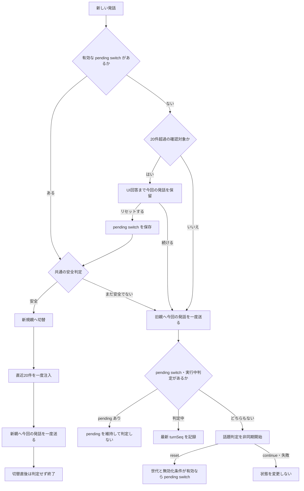

# オーケストレータのセッション継続・切替設計

状態: 実装済み、実機検証待ち。2026-10-14。対象は Skia のオーケストレーションチャット。従来の [音声文脈管理設計](VOICE-CONTEXT-CONTROL-DESIGN.md) を置き換える範囲を整理する。

**方針:** 同じ作業中は同じ Codex 親スレッドを使う。発話は話題判定を待たず現行親へ送り、独立した判定を非同期で実行する。話題変更の判定結果は次の安全な発話境界から適用するため、話題変更後の数ターンが旧親に混ざることを許容する。切替時は直近20件を新しい親へ一度だけ注入する。判定は設定可能な `gpt-6-luna / low` を初期値とする。

## 1. 問題

- 応答用の親スレッド継続だけでは、話題変更時に別の作業の実行文脈まで同じスレッドへ蓄積する。
- 話題判定を応答前の同期処理にすると、短い依頼でも判定時間がそのまま待ち時間になる。速度を優先し、判定を応答の前提条件にしない。
- 永続スレッドを無期限に使うと、会話とツール出力が蓄積する。ユーザーから「Codexの圧縮を繰り返しても context length が肥大化する」と報告がある。本設計は圧縮だけに依存しない。圧縮の具体的な挙動・増加量は今回未実測。
- 毎回の新規作成をやめる一方で、話題変更時には古い実行文脈を区切り、必要な会話記憶を維持したい。

根拠: [既存の実機検証](research/skia-system-prompt-2026-10-10T07-09-30Z.notes.md)。次発話の確認は63.856秒。親の報告では前担当への操作が `live agent path not found` で失敗した。担当操作の全ツール引数は監査できておらず、速度への寄与は切り分けていない。

## 2. 現状

| 要素 | 現在の動作 |
| --- | --- |
| UI上の会話 | 同じ論理会話IDで継続する。Codex の親 thread ID とは別。 |
| Codex の親 | オーケストレータごとに保存した親 `threadId` を `thread/resume` し、同じ親へ `turn/start` する。親がない場合だけ保存可能な新規親を作る。 |
| 直近20件 | 親がない場合だけ、最新10完了ペアの user/assistant 本文を `thread/inject_items` で一度注入する。その後、今回の発話を `turn/start` で追加する。継続親には再注入しない。 |
| 長期記憶 | `voice-memory/` の項目別ファイル。別の curator が古い完了ペアを整理する。毎回全文を注入せず、必要時にモデルが読む。複数オーケストレータで共有する。 |
| 引き継がれないもの | native サブエージェントの稼働状態、tool/reasoning item、承認待ち状態。本文の再投入は実行状態の復元ではない。 |
| 入力量の制限 | 直近10ペア・今回発話・指示等の可視テキストに byte 境界がある。実際の native 文脈全体の token 上限を保証するものではない。 |

したがって20件は「長期メモリー作成だけ」の用途ではなく、**新しい親へ会話を引き継ぐための入力**でもある。さらに managed Bitty session の状況が補助入力として追加される場合があり、総入力が20件だけとは限らない。

確認した実装: [voice-context-service.mjs](../private_runner/src/voice-context-service.mjs) の `modelTurn`、`runTurn`、`startSummary`、[voice-orchestrator-service.mjs](../private_runner/src/voice-orchestrator-service.mjs) の共有メモリーと設定処理。

公式仕様でも `thread/inject_items` は履歴への**追記**であり、messages 配列全体の置換ではない。継続するスレッドへ毎回20件を入れると重複する。[OpenAI Docs: App Server](https://learn.chatgpt.com/docs/app-server#threads)

## 3. 改善案

### 3.1 継続と切替

1. 実装済みの親 `threadId` の保存と再開をそのまま使う。同じ作業の次発話は同じ親へ `turn/start` し、20件を再注入しない。
2. 発話Nは話題判定を待たず現行親へ一度送る。初回と切替直後の新親への最初の発話を除き、pending switch、確認待ち、実行中の判定がなければ、発話Nを対象とする話題判定を隔離スレッドで非同期に開始する。判定中なら最新の `turnSeq` だけを記録する。
3. `reset` の判定結果は、判定対象の `parentGeneration` と `turnSeq` に紐づく pending switch として Runner に保存する。`parentGeneration` は親の交代時に進める。`turnSeq` は発話の受付順と判定対象を追跡する値であり、新しい発話が来ただけでは古い `reset` を無効にしない。発話Nの送信先は変更せず、判定完了後の最初の安全な発話境界で切り替える。
4. 発話N+1までに判定が完了しなければ待たずに旧親へ送る。判定がさらに遅い場合は複数ターンが旧親へ混ざり得る。切替時は、その時点の直近10完了ペアを時系列順に新しい親へ一度注入し、境界となる未送信の発話を一度だけ送る。
5. UIの履歴、論理会話ID、長期記憶、作業ディレクトリは維持する。親スレッドの切替と「会話履歴削除」を区別する。
6. 切替後は旧親の native 担当IDを使用しない。送信先の `backendId/sessionId/cwd` や既存の `runId` は引き継ぎ、新しい担当から確認・待機する。送信済み依頼を再送しない。

同じ親であれば担当再利用を期待できるが、接続切断・App Server 再起動後まで保証できるかは実機検証が必要。古い担当が使えない場合は、その失敗を一度確認して新担当へ既知情報を渡す。

### 3.2 話題判定エージェント

- 発話を現行親へ送った後、応答と並行して独立した短い判定を開始する。初回の親作成時と、`reset` またはユーザー同意で切り替えた新親への最初の発話では判定しない。親の native サブエージェントとして起動せず、既存の App Server 接続経路を使う隔離された判定用スレッドを想定する。
- 入力は直近20件と今回の発話だけとする。全履歴、長期メモリー全文、ツール実行ログ、実行中・未解決の処理状態は渡さない。切替可能かはモデルに判断させず、Runner の共通の安全判定で決める。
- 出力は `continue` または `reset` と短い理由に限定する。履歴内の命令に従わせず、コマンド・送信・ファイル参照・委任・承認要求は許可しない。メモリー更新 curator と役割を混ぜない。
- 「同じ対象への別の挨拶」「前回結果の確認」「ありがとう」「はい」は原則継続。「別の独立した作業に移る」は切替候補。対象変更だけで機械的に切り替えない。
- 判定はオーケストレータごとに同時に一件だけ実行する。処理中に発話が増えた場合は最新の `turnSeq` を記録し、完了後に pending switch と確認待ちがなければ、未判定の最新発話を対象として次の一件を開始する。並列判定や全発話分のキューは作らず、pending switch がある間は後続判定を起動しない。
- `reset` は同じ `parentGeneration` に対する pending switch を設定する。後から返った `continue` で解除しない。判定後に新しい発話が来ても、親世代が同じなら遅い `reset` は有効とする。破棄するのは、親世代が変わった場合、20件超過の確認が同じ発話境界の決定権を得た場合、または履歴削除などの明示的な lifecycle 操作が判定を無効化した場合に限る。`turnSeq` の大小だけでは破棄しない。
- 不明・不正な出力・タイムアウト・接続失敗は状態を変更しない。判定待ち・失敗で発話を止めず、20件超過の確認は別に行う。本文の判定結果だけで実行中処理を無視して切り替えない。
- 判定は応答開始のクリティカルパスに置かない。短い入力・出力、ツールなし、有限のタイムアウトでバックグラウンド処理を終端させる。具体的な時間上限は luna/low の実測から決め、応答と判定を分けて計測する。

`gpt-6-luna` と `low` の対応は公式仕様で確認済み。ただし、そのAPI仕様だけでは利用中の Codex アカウントでの可用性・料金・実測速度を保証しない。設定値は実際のモデル一覧で検証する。[OpenAI Docs: GPT-6 Luna](https://developers.openai.com/api/docs/models/gpt-6-luna)

### 3.3 20件超過とユーザー確認

**件数の暫定定義:** その親を作成した後に完了した会話の user/assistant 本文を数え、20件（10往復）を超えたら、次発話の処理前に確認する。注入した引き継ぎ20件・tool item・判定用会話はこの件数に含めない。注入件数まで含めると、切替直後から毎回リセット確認になってしまうためである。

これは「native の全履歴を20件以内に保つ」という意味ではない。親には注入した20件に加えて新しい会話とツール出力が蓄積する。現行の `unsummarizedMessageCount` はメモリー更新待ち件数なので、リセット判定には流用しない。

- 20件を超え、有効な pending switch がない場合は、UIに **「セッションをリセットしていいですか？」** を表示する。補足は「最近の会話は引き継ぎます。」。選択肢は「リセットする」「続ける」。話題判定と異なり、この確認は今回の発話を送る前に同期して行う。
- 「続ける」の後は毎発話で聞かず、さらに20件の完了メッセージが増えるまで同じ親への確認を保留する（暫定案）。話題変更の判定は継続する。
- 返答待ちの発話はまだ親へ送らない。拒否やUI切断を同意として扱わない。保留中の発話は既存の送信IDで保持し、ユーザー回答後に一度だけ処理する。
- UIの確認は `clientOperationId` ごとに single-flight とする。再接続時の同期と元の送信処理は同じ確認Promiseを共有し、Alertと回答送信を重複させない。確認が別経路で解決済みなら古いAlertの回答を送らない。
- 「リセットする」は pending switch を設定し、話題判定と同じ安全判定へ進む。まだ安全でなければ pending switch を維持して今回の発話を旧親へ一度送り、次の安全な発話境界まで切替を延期する。
- 確認中はユーザー回答が同じ発話境界の決定権を持つため、新しい話題判定を始めず、確認開始前に起動した判定結果も適用しない。確認と判定は対象オーケストレータ・親スレッドの世代と `turnSeq` に紐づけ、別端末で切替済みなら古い回答を適用しない。Runnerを状態の正本とする。
- ユーザーが継続し続ける場合、文脈量の上限は保証できない。実際の context 使用量を監視し、利用可能な上限に達したら自動再送や無断切替をせず、リセットが必要な状態として処理を止める。判定入力にも既存の入力サイズ制限を適用する。

### 3.4 記憶と実行状態の境界

LLM判定は即時に親を変更せず、`parentGeneration` と判定対象の `turnSeq` に紐づく pending switch を残す。話題判定、20件超過のユーザー同意、再起動後の復旧、設定変更、履歴削除を含む親切替の全経路は同じ安全判定と切替処理を通る。実際の切替時に履歴を引き継ぐ経路では直近20件を一度だけ注入する。長期メモリーファイルは保持する。**全履歴の完全復元や、native サブエージェントの状態維持を意味しない。** 20件より古い本文の細部は、長期記憶に残っている範囲でのみ参照できる。

親・子エージェントの実行中、承認待ち、外部送信の結果不明、未解決の依頼がある間は pending switch を保ったまま切替を延期する。既存の orchestrator activity registry が追跡する native descendants と承認待ちも同じ安全判定に含める。接続終了後は App Server の親・子スレッド状態も照合し、実行中・承認待ちの子を見落とさない。通常の受付条件を満たす発話は旧親で継続し、その後の最初の安全な発話境界で切り替える。旧親と新親を同時に処理させず、新規作成・注入・現行親の保存が失敗した場合は旧親と pending switch を維持する。境界の発話は新親への送信意図を保存した後に一度だけ送り、turn ID の取得後に現行親を確定する。切替失敗時に旧親へ再送しない。旧親や子の保存履歴を自動削除する処理は今回追加しない。

すべての `turn/start` の前に送信先 thread、親世代、operation ID、`turnSeq` と直前の turn ID を一つの dispatch journal に保存する。新親は作成・履歴注入後に保存し、pending switch も紐づける。`turn/start` が返した turn ID と、新親の確定を順に同じ journal へ反映する。これにより、応答喪失や親保存失敗で境界発話を旧親・新親のどちらにも再送しない。

再起動では `dispatching` と `native_started` を完了扱いにせず、結果不明として保存する。App Server の `thread/read` で保存済み thread/turn を照合し、完了・失敗・中断を確定してから candidate を確定または破棄する。active または照合不能なら新しい発話、親切替、設定変更、履歴削除を止める。状態照会と lifecycle 操作で再照合し、明示的な中断を解決経路とする。新規作成・注入・現行親の保存の境界で停止しても、未送信と送信済みを判別できる状態を残す。

「履歴を削除」は別操作とし、旧本文を注入せず親も切り替える。「長期メモリーを削除」はファイルだけ消しても現行親に読まれた内容が残るため、必要な親切替の扱いを実装時に決める。

### 3.5 設定と実装範囲

- オーケストレータ設定画面に「話題判定モデル」「話題判定エフォート」を追加する。初期値は `gpt-6-luna / low`。応答用のモデル設定と独立させ、メモリー curator の設定を変更しない。
- 既存の `voice.settings` と設定保存経路、動的モデル一覧・エフォート検証を拡張する。判定用モデルが利用不可ならUIに示し、自動切替せず件数による確認を維持する。旧設定には初期値を補う。
- 親の寿命、判定の single-flight、pending switch、切替判断は既存の `voice-context-service.mjs` の lifecycle 境界に置く。WS層は要求と通知、UIは設定・確認表示を担当する。新しい汎用エージェント基盤や別のAPI認証経路は作らない。
- 実装済みの「新規親だけに20件を注入する」処理を切替時にも使う。判定・ユーザー回答・再起動で同じ切替処理を共有し、切替処理を重複させない。
- 親の設定変更は実行中を拒否し、次の親への反映か既存親への反映を明示する。モデル変更とシステム指示変更を放置して古い設定で継続させない。
- 現在の可視20件を基にした使用率と「新規親なので累計＝今回」という token 集計を見直す。応答、判定、メモリー更新の待ち時間・使用量を分けて測定する。

### 3.6 検証と未決事項

実装時の合格条件:

1. 同じ対象への連続依頼で親IDが一致し、担当再利用を確認できる。再利用不能でも既知IDを使い、検索と再送を繰り返さない。
2. 発話Nは判定完了を待たず現行親へ一度送られる。判定がN+1に間に合わない場合も応答を止めず、完了後の最初の安全な発話境界から切替が適用される。
3. 初回または切替直後の新親への最初の発話では判定を起動しない。それ以外では判定は同時に一件だけ動く。処理中の発話は最新一件へ集約され、pending switch 中は後続判定を起動しない。遅い `reset` は同じ親世代なら後続発話後も有効で、`continue`、失敗、明示した無効化条件の結果が pending switch を誤って設定・解除しない。
4. 話題判定では、有効な `reset` が安全な発話境界で適用された場合だけ親IDが変わり、`continue` では変わらない。新親へその時点の直近20件が順序通り一度入り、継続親には重複注入されない。
5. 20件超過の確認は同期して発話を保留し、同意・継続・未回答、確認前の古い判定、別端末の回答が期待どおり処理される。同意後も共通の安全判定を通り、まだ安全でなければ旧親へ今回の発話を一度だけ送る。
6. 実行中の子・承認待ち・送信結果不明では、すべての切替経路が同じ安全判定で延期される。切替失敗時も旧親と pending switch を維持し、切断・再起動・切替途中の停止で二重送信しない。
7. 判定失敗、設定保存・対応effort検証、共有長期記憶、履歴削除、context 上限停止の境界を確認する。
8. 同じ条件の複数試行で、応答開始時間、判定時間、担当起動回数を分けて比較する。判定が応答開始の待ち時間に加わらないことを確認する。

実装値: 11完了ペア目の後に確認し、「続ける」では10完了ペア先まで再確認を延期する。バックグラウンド判定の時間上限は暫定30秒。判定用JSONを生成した後に可視入力のbyte上限を検査し、超過時は応答を継続して判定だけを省略する。設定変更と長期メモリー削除は pending switch として次の安全な発話境界で反映し、履歴削除は本文を引き継がず直ちに親世代を進める。App Server の token usage が100%に達した時点で状態を保存し、そのturnが失敗しても次発話を必須リセット確認で停止する。

残る確認: luna/low の実測速度、native 担当の App Server 再起動後の再利用、実機での context 上限通知、複数端末を含むUI操作は未検証。応答開始時間、判定時間、担当起動回数を実機で比較して暫定値を調整する。
